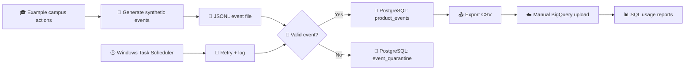
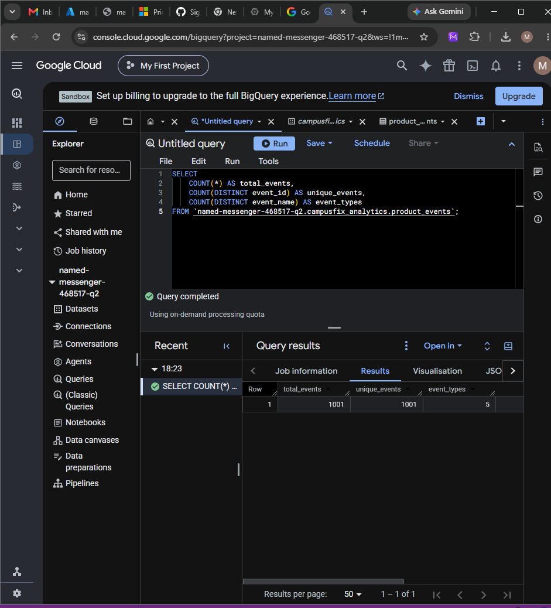
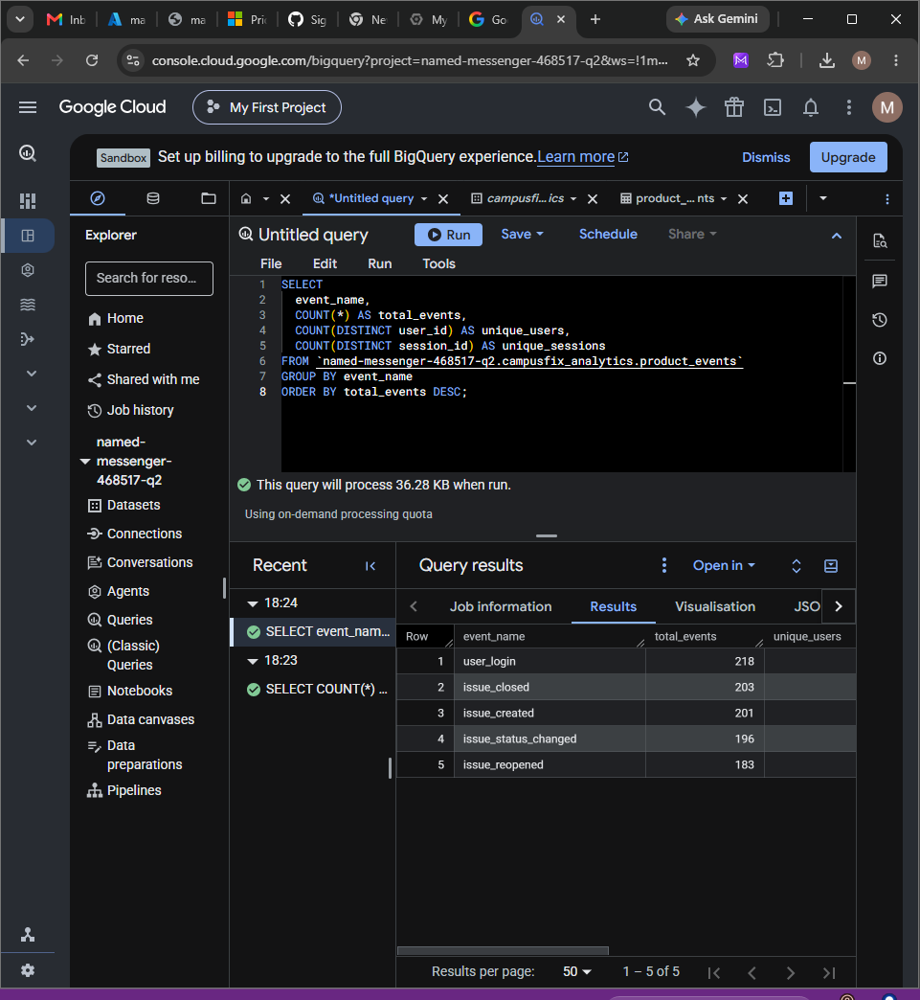
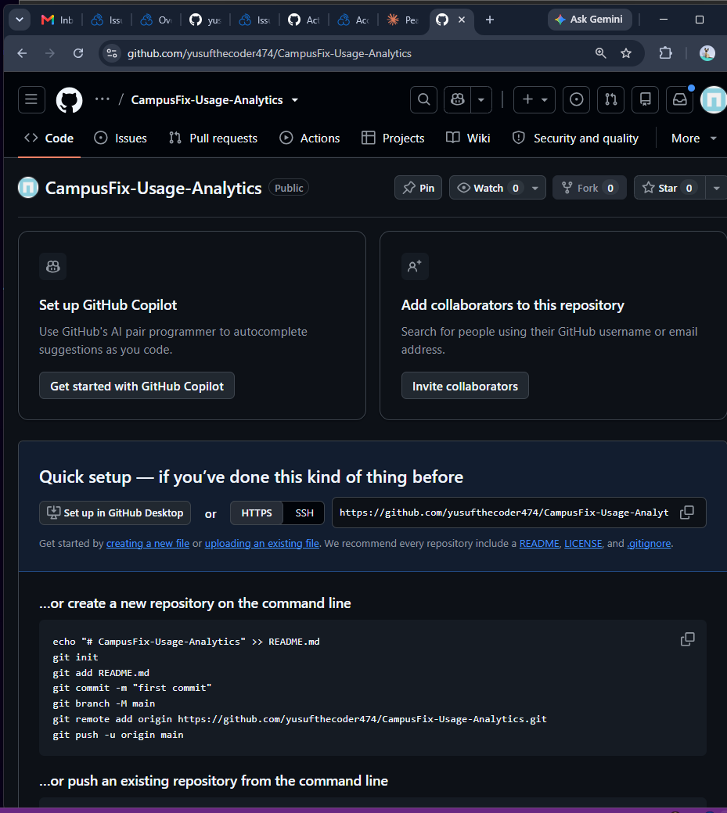
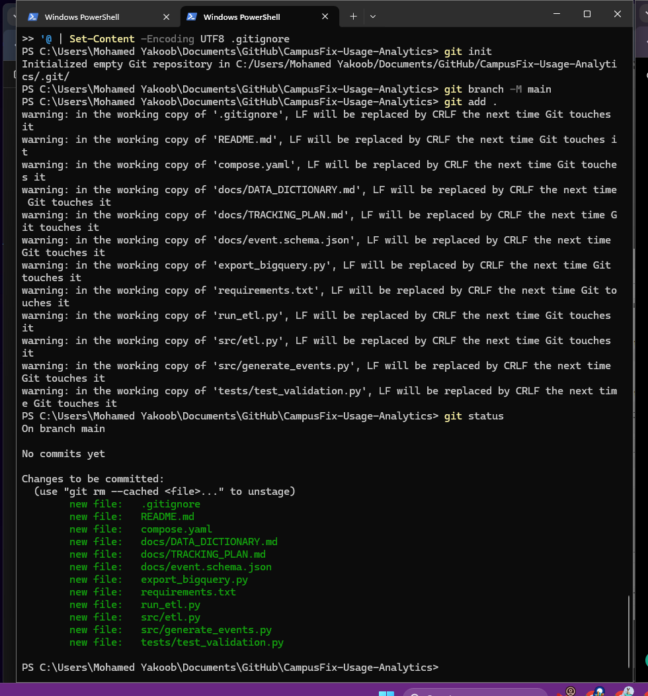
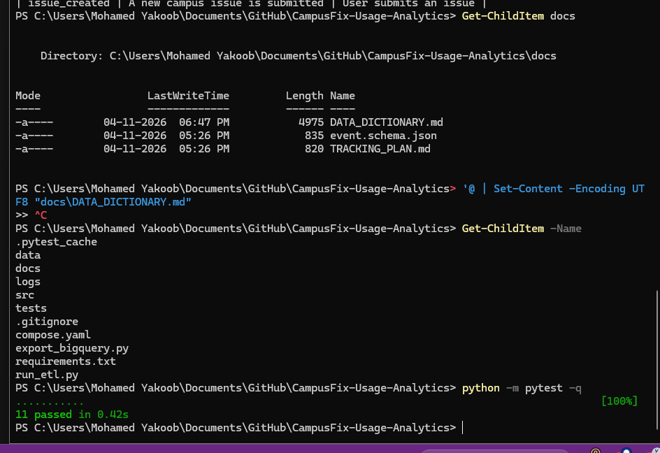

<div align="center">

# CampusFix Usage Analytics

**From campus activity to trustworthy, understandable data.**

A small data engineering pipeline that checks product events, keeps valid records, separates bad data, and prepares usage reports.

    

[How it works](#how-it-works) · [See the results](#results-from-the-demonstration) · [Run it](#run-it-on-your-computer) · [Screenshots](#screenshots) · [Limitations](#what-is-not-built-yet)

</div>

## The idea, in plain English

Imagine a college maintenance app. A student reports a broken classroom fan. Later, a technician updates the request and closes it. Each action *could* become an event that helps answer questions such as: Which actions happen most often? How many different people use the app? Are requests being reopened?

This project demonstrates the **analytics side** of that idea. It generates example CampusFix-style events, checks them, saves valid events, and makes them available for SQL analysis. **The events are simulated, not collected from real CampusFix users.**

## Results from the demonstration

| Check | Observed result | What it means |
|:--|--:|:--|
| Valid events stored | **1,001** | Events available for analysis |
| Different event types | **5** | Login and four issue-related actions |
| Invalid records quarantined | **3** | Bad records are kept separately for inspection |
| Automated tests | **11 passed** | Local validation test suite completed |
| Duplicate records on rerun | **1,000** | Previously loaded source events were not inserted again |
| GitHub Actions | **Passed** | Python test workflow succeeded on GitHub |

These are results recorded on **4 November 2026**, not live production metrics. The 1,001 valid events include 1,000 generated events plus one additional valid test event. The three invalid records were separate test inputs.

## How it works



**Think of it like a sorting desk.** Every event arrives with a label. The validator checks whether the label and details are complete. Good events go into the main database; bad events go into a separate review area. If the same event arrives twice, the database keeps only one copy of that event ID.

### Five events the system understands

| Event | Everyday example |
|:--|:--|
| `issue_created` | A student reports a broken fan |
| `issue_status_changed` | A technician marks the issue as in progress |
| `issue_reopened` | A student says the repair did not solve the problem |
| `issue_closed` | An authorized user closes the issue |
| `user_login` | A user signs in |

Each event includes an ID, event name, timestamp with timezone, synthetic user ID, session ID, schema version, and JSON properties. See [the data dictionary](docs/DATA_DICTIONARY.md) and [tracking plan](docs/TRACKING_PLAN.md).

## Screenshots

These are actual screenshots from the project walkthrough, included in this repository. They show the BigQuery analysis, automated tests, and ETL scheduling. No new screenshots are needed.

### BigQuery: the events reached the analytics table



### Which actions did people take in the sample data?



### GitHub Actions: tests run automatically when code is pushed



### Local tests: validating the pipeline



### Scheduled ETL: checking the daily job and log



> These screenshots document a demonstration using generated data. They do not prove production traffic or live application instrumentation.

## Run it on your computer

You need **Python 3.11**, **Docker Desktop** with Docker Compose, and PowerShell (Windows). Run these commands from the repository folder.

**1. Install Python packages**

```powershell
python -m pip install -r requirements.txt
```

**2. Start PostgreSQL**

```powershell
docker compose up -d
```

The Compose file runs PostgreSQL 16 and exposes it only on `127.0.0.1:55433`. The included password is for **local development only**. Change it before using any shared or deployed environment.

**3. Generate 1,000 sample events**

```powershell
python src/generate_events.py
```

This creates `data/events.jsonl`. The event values are synthetic and generated locally.

**4. Load events and inspect the log**

```powershell
python run_etl.py
Get-Content .\logs\etl.log -Tail 10
```

The loader validates events, inserts new ones, ignores duplicate IDs, and records rejected lines in the quarantine table. Rerunning the same file should not create duplicate rows.

**5. Run the tests**

```powershell
python -m pytest -q
```

The included test suite checks schema validity, required fields, UUID format, supported event names, and timestamp timezones. It does **not** constitute an end-to-end production test.

**6. Export validated events for BigQuery**

```powershell
python export_bigquery.py
```

The output is `data/bigquery_events.csv`. In the Google Cloud BigQuery console, create or select a dataset, create a table from the CSV, and use the seven columns described in [the data dictionary](docs/DATA_DICTIONARY.md). Set **Header rows to skip = 1**. Uploading is currently a manual operation.

**7. Try a simple BigQuery report**

Replace `YOUR_PROJECT.YOUR_DATASET` with your own BigQuery project and dataset identifiers:

```sql
SELECT
  event_name,
  COUNT(*) AS total_events,
  COUNT(DISTINCT user_id) AS unique_users,
  COUNT(DISTINCT session_id) AS unique_sessions
FROM `YOUR_PROJECT.YOUR_DATASET.product_events`
GROUP BY event_name
ORDER BY total_events DESC;
```

The example table was created in BigQuery in the `asia-south1` region. You can choose your own dataset name and region.

## Project files

```text
CampusFix-Usage-Analytics/
├── src/
│   ├── generate_events.py      # Create example events
│   └── etl.py                  # Validate and load into PostgreSQL
├── tests/test_validation.py   # Automated validation tests
├── docs/
│   ├── DATA_DICTIONARY.md     # Field meanings and verified results
│   ├── TRACKING_PLAN.md       # Event definitions
│   ├── event.schema.json      # Machine-readable validation rules
│   ├── SCREENSHOTS.md         # Optional screenshot guidance
│   └── screenshots/          # Captured demonstration screenshots
├── .github/workflows/tests.yml # GitHub Actions tests
├── compose.yaml               # Local PostgreSQL service
├── run_etl.py                 # Retry and logging wrapper
├── export_bigquery.py         # CSV export for manual upload
└── requirements.txt
```

## Reliability and data quality

- **Schema validation:** rejects missing or incorrectly formatted fields.
- **Timezone handling:** requires timestamps with a timezone and converts them to UTC.
- **Duplicate protection:** `event_id` is a PostgreSQL primary key, and inserts use `ON CONFLICT DO NOTHING`.
- **Quarantine:** stores rejected raw lines with the reason and a SHA-256 fingerprint.
- **Retries and logs:** the wrapper retries failed ETL attempts and writes `logs/etl.log`.
- **Continuous integration:** GitHub Actions runs the Python tests on pushes and pull requests.

## What is not built yet

This is a **local demonstration pipeline**, not a production analytics platform. There is no live CampusFix instrumentation, no automatic PostgreSQL-to-BigQuery sync, no demonstrated late-event reconciliation, and no verified failure alerting. The daily schedule depends on the Windows computer and PostgreSQL being available. A manually triggered Task Scheduler run succeeded; the first unattended scheduled run was not verified in the supplied evidence. Apache Airflow is not part of this project.

## Privacy and safety

The generator uses synthetic identifiers. The tracking plan explicitly excludes passwords, email addresses, names, cookies, and authentication tokens. Before publishing screenshots, hide any personal information, cloud credentials, and private project details.

## Project status

Built as a practical learning project for **Python, data validation, PostgreSQL, ETL, SQL analytics, and automated testing**. The goal is to show a complete, understandable data flow while being clear about what has and has not been demonstrated.
